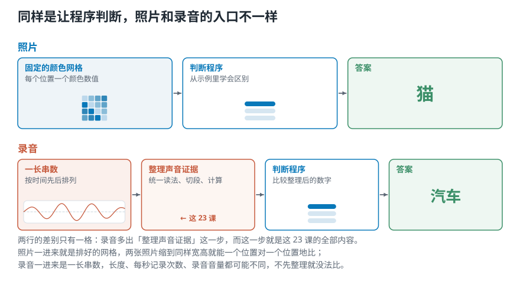

# 第 1 课 课程导论：程序要分辨音乐类型，先得跨过哪一步

> **前情提要：** 这是第一课，前面没有要补的。会一点 Python 就够，不需要任何音频基础。
>
> **本课目标：** 弄清三件事：这门课要让程序做什么，为什么录音不能直接拿去比，23 课按什么顺序走。读完你能说出「一段录音在程序眼里是什么」。
>
> **对应视频：** 原课程第 1 集《Overview》，约 9 分钟（[播放列表](https://www.youtube.com/playlist?list=PL-wATfeyAMNqIee7cH3q1bh4QJFAaeNv0)）。
>
> **配套代码：** 演示脚本 [`lesson01_course_map.py`](../../音频信号处理二十三讲/课程代码/lessons/lesson01_course_map.py)，练习 [`练习/lesson01`](../练习/lesson01/)。

<picture>
  <source media="(max-width: 640px)" srcset="../../音频信号处理二十三讲/第01-05课/figures/mobile/00-course-position-01.svg">
  
</picture>

## 1.1 一段录音，在程序眼里是什么

先看照片。给程序很多张标好「猫」的照片，再给它一张没见过的，让它判断是不是猫。这类程序叫**分类程序**：从带答案的例子里找出差别，再把新东西归到某一类。

照片好办，因为**它本身就是一张排好的数字网格**：宽多少点、高多少点、每个点什么颜色。两张照片缩放到同样大小，就能一格对一格地比。

录音不一样。麦克风每隔极短的一瞬，量一次空气被推挤的强弱，记下一个数。课程自带的一段人声，读进来是这样：

```text
voice.wav：30.00 秒
每秒 22050 个数，共 661500 个数
相邻两个数隔 0.0454 毫秒
从第 1.000 秒开始的 8 个：
+0.0331, +0.0280, +0.0277, +0.0327,
+0.0370, +0.0366, +0.0318, +0.0245
```

**这就是程序拿到的全部：66 万个按先后排好的小数。** 单独一个数说明不了什么，「第 1 秒那一刻是 +0.0331」这句话没有任何用。声音藏在成千上万个数的起伏里。

网页版在这里放了一个实验：把这段人声一路放大，从整段 30 秒放大到几毫秒，直到能看清一个个数，边看边听。

## 1.2 缺的那一步：把一串数整理成证据

照片和录音都叫「分类」，但录音多了一道工序：

- 两段录音**长短不同**，一段 3 秒、一段 30 秒，数的个数差十倍，没法一个位置对一个位置地比。
- 两段录音**每秒记的次数可能不同**，同样 1 秒，一段 44100 个数、一段 22050 个数。
- 一串数里，**哪些是声音本身，哪些只是录的时候离麦克风近**，光看数字看不出来。

<picture>
  <source media="(max-width: 640px)" srcset="../../音频信号处理二十三讲/第01-05课/figures/mobile/01-course-problem.svg">
  
</picture>

*图 1：照片一进来就是排好的网格；录音一进来是一长串随时间排列的数。中间那一步，就是这 23 课的全部内容。*

所以做一个声音分类系统，要分两段：

1. **整理数据**：把那串数读懂、切开，算成一组能互相比较的数。这组数叫**特征**，它是交给分类程序的证据。
2. **训练模型**：分类程序学会判断规则以后，业内叫它**模型**。拿特征去训练它、调它、上线它。

第一段叫**音频信号处理**，这 23 课只做这一段。第二段不在范围内。这样划线有个实在的理由：**证据没找对，后面换多大的模型都补不回来。**

## 1.3 整理好之后，能做哪些事

同一套处理，往上能接很多任务：

- **认声音**：警报、玻璃破碎、机器出故障。
- **认人和话**：语音转文字，核对说话的是不是本人，分出一段对话里谁在什么时候说话。
- **修录音**：去掉杂声，把音质偏低的录音补清楚。
- **分析音乐**：认乐器、找节拍、判断情绪和风格。这一块有个专门的名字，叫**音乐信息检索**。

这门课挑「古典、爵士、摇滚三选一」当贯穿全程的验收题。它结果一看就懂；每学会一种计算，都能回来问一句：**这个数真的帮得上区分这三种音乐吗？**

## 1.4 23 课怎么走

整条路分七段。每一段都在回答上一段留下的问题：

| 课 | 这一段回答什么 | 学完手里多了什么 |
|---|---|---|
| 01 | 要解决什么问题 | 任务、素材和标签表 |
| 02—04 | 声音是什么，怎样变成数字 | 读懂那串数的含义 |
| 05—06 | 该算哪些特征，按什么步骤算 | 一条「载入→切段→计算→汇总」的流水线 |
| 07—09 | 只看强弱随时间的起伏，能问出什么 | 三个时域特征 |
| 10—16 | 一段声音由哪些高低成分组成 | 频谱和声谱图 |
| 17—20 | 怎样按人耳的方式重排这些成分 | 梅尔频谱、MFCC |
| 21—23 | 怎样把成分分布压成几个数 | 质心、带宽等统计量 |

后面每一课开头的「前情提要」都会接上这张表：上一课留下了什么问题，这一课怎么接。完整路线图在[课程总纲](../../音频信号处理二十三讲/课程总纲/README.md)。

## 1.5 怎么学这门课

**每个概念讲两遍。** 一遍讲原理，一遍写代码，跑出真实结果。正文只留看懂实验必需的几行，完整脚本在[课程代码目录](../../音频信号处理二十三讲/课程代码/README.md)。

**工具全程是 Python。** 数组计算用 NumPy，读音频和音频专用函数用 librosa，画图用 Matplotlib，个别函数来自 SciPy。不需要 API Key，不需要联网，环境在[课程总纲](../../音频信号处理二十三讲/课程总纲/README.md)里装一次就够。

**公式不用怕。** 每个公式都先用一句话说它在干什么，再用代码算一遍。看不懂先跑脚本、看输出，有了直觉再回头看，公式往往只是把你已经懂的事写紧凑了。

**学完的标准只有一条：** 看到一张声谱图（同时画出时间和高低成分的那张图，第 16 课讲）不慌，知道它在说什么，能用代码算出来，还能说清它保留了什么、丢掉了什么。

## 1.6 实验：先确认素材程序都能读到

项目真正的第一步，是把任务、文件和标签定下来。三段主素材：

```python
COURSE_AUDIO = [
    ("debussy.wav", "古典"),
    ("duke.wav", "爵士"),
    ("redhot.wav", "摇滚"),
]
```

约定：将来交给分类程序的是**一段 1 秒的音乐**，程序输出三个标签之一。运行脚本，它只读文件头，不改任何东西：

```bash
python lessons/lesson01_course_map.py
```

```text
debussy.wav | 古典
  30.00 秒 | 22050 Hz | 1 声道
duke.wav | 爵士
  30.00 秒 | 22050 Hz | 1 声道
redhot.wav | 摇滚
  30.00 秒 | 22050 Hz | 1 声道
```

三段都是 30 秒、每秒 22050 个数、一路声音。**声道**就是一个文件里同时存了几路声音：单声道一路，立体声左右两路。主素材格式一致，项目有了共同的起点。脚本还写出一张三行的 `dataset_manifest.csv`，后面每一课都从这张表读文件名和标签。

再看课程自带的七段对照素材，它们后面讲音高、音色、噪声时要用：

```text
noise.wav    26.37 秒 48000 Hz 2 声道
piano_c.wav   1.54 秒 44100 Hz 2 声道
sax.wav       1.31 秒 44100 Hz 2 声道
scale.wav     7.93 秒 44100 Hz 2 声道
tremolo.wav  14.12 秒 44100 Hz 2 声道
violin_c.wav  2.71 秒 44100 Hz 2 声道
voice.wav    30.00 秒 22050 Hz 1 声道
出现了 3 种「每秒记录次数」
```

**1.2 里说的麻烦，在自己的素材里就碰上了**：三种每秒记录次数，单声道和立体声混在一起。这样的文件不能直接放进同一张表里算。每秒记多少次意味着什么，第 04 课讲；读进来时怎样统一，第 06 课做。

## 📌 本课小结

- **一段录音在程序眼里是一长串数。** 30 秒人声就是 66 万个小数，单独一个数没有意义。
- **声音分类分两段：整理数据和训练模型。** 这门课只做第一段，把录音算成能比较的特征。
- **证据决定上限。** 特征没选对，换多大的模型都补不回来。
- **23 课分七段走**，每段回答上一段留下的问题。
- **素材格式不一定统一。** 课程自带的七段对照素材就有三种每秒记录次数，用之前要先统一。

## 📖 本课术语

| 中文 | 英文 | 一句话解释 | 首次出现 |
|---|---|---|---|
| 分类程序 | Classifier | 从带答案的例子里学出差别，再把新东西归到某一类的程序 | 第 01 课 |
| 模型 | Model | 学好了判断规则的那个分类程序 | 第 01 课 |
| 特征 | Feature | 从录音里算出来、能互相比较的一组数，是交给模型的证据 | 第 01 课 |
| 音频信号处理 | Audio signal processing | 把录音那串数读懂、切开、算成特征的这一整套方法 | 第 01 课 |
| 音乐信息检索 | Music information retrieval (MIR) | 用程序分析音乐：认乐器、找节拍、判断风格和情绪 | 第 01 课 |
| 声道 | Channel | 一个音频文件里同时存的几路声音，单声道一路，立体声两路 | 第 01 课 |

## 🧪 动手练习

练习在 [`练习/lesson01`](../练习/lesson01/)：打开 `exercise.py`，把标着 `TODO` 的地方补上，再运行一条命令检查。

```bash
pip install -r 音频信号处理二十三讲/课程代码/requirements.txt pytest
pytest 音频信号处理二十三讲-v2/练习/lesson01        # 检查你写的
pytest 音频信号处理二十三讲-v2/练习/lesson01 --solution   # 看参考答案能不能过
```

1. **读文件头**：写 `describe(path)`，返回时长、每秒记录次数、声道数和总共多少个时刻。
2. **秒数换个数**：写 `seconds_to_count(seconds, sr)`，1 秒的音乐片段在 22050 Hz 下是多少个数。
3. **格式一致吗**：写 `same_format(paths)`，判断一批文件的每秒记录次数和声道数是否全都相同。三段主素材应该是 `True`，七段对照素材应该是 `False`。
4. **看看那串数**：写 `peek(path, at_s, n)`，取出第 `at_s` 秒开始的 `n` 个数，和正文 1.1 的 8 个数对上。

## ✅ 小测验

**1. 一段 30 秒、每秒记录 22050 次的单声道录音，程序拿到的是什么？**

- A. 一张 30 × 22050 的图片
- B. 661500 个按时间先后排好的数
- C. 30 个数，每秒一个
- D. 一串音符

<details><summary>看答案</summary>

**B**。30 × 22050 = 661500。录音不是网格，是一长串有先后顺序的数。

</details>

**2. 为什么不能把两段录音的数一个位置对一个位置地直接比？**

- A. 数太多，算不过来
- B. 长短、每秒记录次数可能不同，单个数也说明不了什么
- C. 录音里有负数
- D. 程序只能处理图片

<details><summary>看答案</summary>

**B**。长短不同，个数就不同；每秒记录次数不同，同一个位置对应的时刻也不同；而声音藏在成段的起伏里，不在单个数上。

</details>

**3. 这门课覆盖声音分类系统的哪一部分？**

- A. 只覆盖训练模型
- B. 从整理数据到训练模型、上线全部覆盖
- C. 只覆盖把录音整理成特征这一段
- D. 只覆盖录音设备

<details><summary>看答案</summary>

**C**。23 课停在「为分类程序准备好可信的输入」。模型怎么训练、怎么上线不在范围内。

</details>

**4. 课程自带的七段对照素材，读文件头发现了什么？**

- A. 全都是 22050 Hz 单声道
- B. 有三种每秒记录次数，单声道和立体声混在一起
- C. 全都打不开
- D. 都是 30 秒

<details><summary>看答案</summary>

**B**。22050、44100、48000 三种都有，只有人声是单声道。这正是 1.2 说的麻烦，用之前要先统一。

</details>

## 下一课

程序拿到的是一长串数。这串数从哪来？一个数又代表什么？[第 2 课](02-声音与波形-一次振动怎样变成录音里那条线.md)从一次振动讲起：声音怎样推着空气传到麦克风，麦克风记下的那条线里装着什么。
