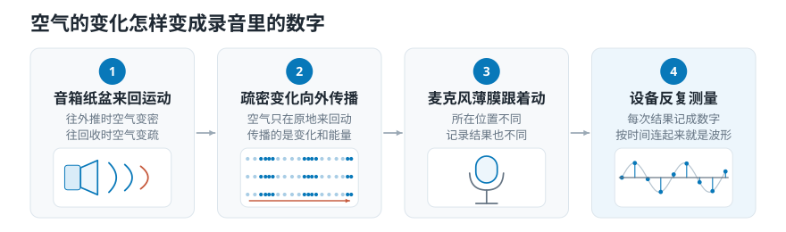
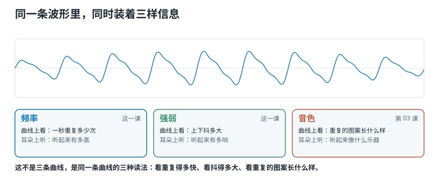
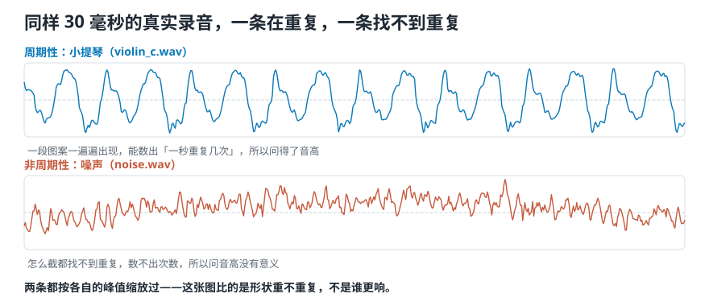
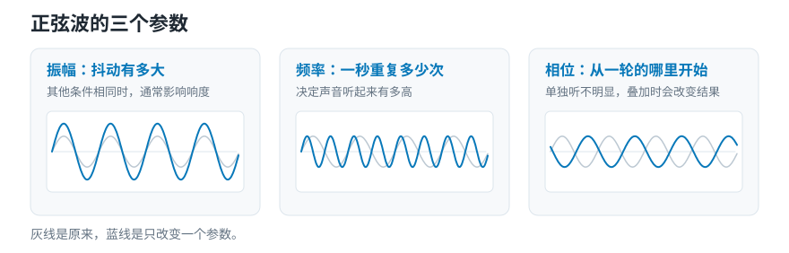
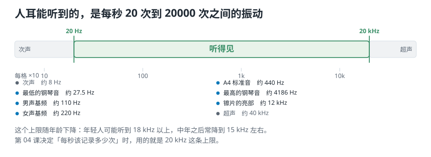
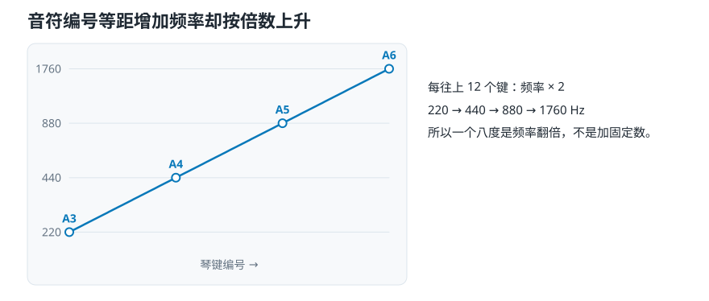

# 第 2 课 声音与波形：一次振动怎样变成录音里那条线

> **前情提要：** [第 1 课](01-课程导论-电脑要怎么分辨音乐类型.md)说，程序拿到的录音是一长串数，30 秒人声就是 66 万个小数。
>
> **本课目标：** 弄清这串数从哪来、记下了什么。学会用三个数描述最简单的声音，并明白一件反直觉的事：耳朵分辨高低，看的是倍数，不是差值。
>
> **对应视频：** 原课程第 2 集《Sound and waveforms》，约 26 分钟（[播放列表](https://www.youtube.com/playlist?list=PL-wATfeyAMNqIee7cH3q1bh4QJFAaeNv0)）。
>
> **配套代码：** 演示脚本 [`lesson02_pitch_and_hz.py`](../../音频信号处理二十三讲/课程代码/lessons/lesson02_pitch_and_hz.py)，练习 [`练习/lesson02`](../练习/lesson02/)。

<picture>
  <source media="(max-width: 640px)" srcset="../../音频信号处理二十三讲/第01-05课/figures/mobile/00-course-position-02.svg">
  
</picture>

## 2.1 声音是空气压力的起伏

拨一下吉他弦，弦在原地来回抖。往一边走，把前面那层空气**挤紧**；往回走，那层空气又**变松**。挤紧的地方压力比平时高一点，变松的地方低一点。**这一高一低的压力变化，就是声音。**

它一圈圈往外传，可传出去的**不是空气，是能量**。每一团空气只在原地来回摆，把「挤」这个动作交给下一团。像体育场里的人浪：浪从左扫到右，没有一个人离开座位。这种在介质里一站站传下去的振动，叫**机械波**。

没有介质就没有声音。真空里放一个正在响的闹钟，你听不见：闹钟在振动，但周围没有空气可推。

<picture>
  <source media="(max-width: 640px)" srcset="../../音频信号处理二十三讲/第01-05课/figures/mobile/02-air-to-numbers.svg">
  
</picture>

*图 1：振动推挤空气，压力变化传到麦克风，被记成一串数。第二格的小点左密右疏，空气本身没有往右跑。*

## 2.2 波形：麦克风那一个点上的记录

麦克风只做一件事：**每隔极短的一瞬，量一次面前的空气压力偏离平时多少，记下一个数。** 第 1 课看到的 66 万个小数就是这么来的。按时间画出来，横轴是时间，纵轴是偏离多少，得到一条上下抖的线，叫**波形**。

两点要记住：

- 波形是**一份记录**，不是声音本身；
- 它记的是**麦克风所在那一个点**。换个位置重录，同一个声源录出来的数就不一样。

<picture>
  <source media="(max-width: 640px)" srcset="../../音频信号处理二十三讲/第01-05课/figures/mobile/02-waveform-carries.svg">
  
</picture>

*图 2：一条波形里同时装着三样东西。*

这么一条简单的线，装的东西出奇地多：

- **频率**：一秒重复多少次，对应你听到的高低；
- **强弱**：上下抖多大，对应你听到的**响度**，也就是「有多响」；
- **音色**：高低和响度都一样，小提琴和钢琴仍然听得出来，剩下的那点差别。

还有时间上的信息：一个音什么时候开始、持续多久，都能在这条线上直接看出来。这一课讲频率和强弱，音色留到第 3 课。

## 2.3 重复的声音，和不重复的声音

真实的波形按「有没有一段图案在重复」分两类：

- **周期性声音**：一段图案反复出现。拉响的琴弦、唱出来的元音、匀速转的电机。
- **非周期性声音**：找不到重复。它又分两种：**连续的**，比如风声、电流底噪，一直沙沙响，这类声音统称**噪声**；**一闪而过的**，比如敲一下桌子、一声「咔」，叫**瞬态**。

<picture>
  <source media="(max-width: 640px)" srcset="../../音频信号处理二十三讲/第01-05课/figures/mobile/02-periodic-or-not.svg">
  
</picture>

*图 3：两条曲线都来自课程自带的录音。上面是小提琴，同一段图案一遍遍出现；下面是噪声，怎么截都找不到重复。*

先听再看：

1. [小提琴：能听出稳定的高低](../../source_course/audio_resources/violin_c.wav)
2. [噪声：只有连续的沙沙声](../../source_course/audio_resources/noise.wav)

**只有周期性声音才能问「这个音有多高」。** 音高就是「一秒重复几次」，不重复的东西数不出次数。对一段噪声调用音高算法，它照样返回一个数，也不报错，但那个数不是音高。

## 2.4 正弦波：三个数说清一条曲线

重复的波形里最简单的一种，是光滑、匀速起伏的**正弦波**，听起来像很干净的电子提示音。三个数就能完全确定它：

- **频率**：一秒重复多少次，单位**赫兹**（Hz）。440 Hz 就是一秒 440 次。重复一次的时间叫**周期**，是频率的倒数，440 Hz 的周期是 1/440 秒。
- **振幅**：离中线最远能到多远，就是上一节说的「强弱」。
- **相位**：这条曲线从一轮里的哪个位置开始画。

$$
x(t) = A\sin(2\pi f t + \varphi)
$$

$A$ 是振幅，$f$ 是频率，$\varphi$ 是相位。乘 $2\pi$ 是把「转几圈」换成「转过多少弧度」。

<picture>
  <source media="(max-width: 640px)" srcset="../../音频信号处理二十三讲/第01-05课/figures/mobile/02-sine-knobs.svg">
  
</picture>

*图 4：灰线是同一条基准曲线。左图更高，波数没变；中图波数翻倍，高度没变；右图形状不变，只是左右平移。*

频率和振幅各管一种听感：**频率越高听着越高，振幅越大听着越响**，两者互不干涉。相位单独听不出来，但它决定这条曲线和**别的**曲线怎样对齐，多条叠在一起时，相位不同，叠出来的结果就不同。

为什么要先学这么简单的曲线？因为**复杂的声音可以拆成一组频率、振幅、相位各不相同的正弦波叠加**。一整支乐队也不例外。第 10 课开始的整个傅里叶部分，就是在做这件拆分。

网页版在这里放了一个实验：拖三个滑杆，边看边听正弦波怎样变。

## 2.5 人耳能听到的范围

**人耳大致能听到每秒振动 20 次到 20000 次的声音**，即 20 Hz 到 20 kHz。

<picture>
  <source media="(max-width: 640px)" srcset="../../音频信号处理二十三讲/第01-05课/figures/mobile/02-hearing-range.svg">
  
</picture>

*图 5：横轴按倍数分格。说话和音乐主要挤在中间那一段。*

- 低于 20 Hz 叫**次声**，高于 20 kHz 叫**超声**。猫、狗、蝙蝠都听得见超声，人听不见。
- 上限随年龄下降，中年之后常常只到 15 kHz 左右。

这个范围后面要用两次：第 4 课决定「每秒该记多少个数」时，20 kHz 是关键依据；第 17 课按听感重新划分频率轴时，也从这里出发。

## 2.6 耳朵按倍数听高低，不按差值

这一课最反直觉的地方在这里。三组音：

| 从 | 到 | 差多少赫兹 | 是多少倍 |
|---|---|---|---|
| 220 Hz | 440 Hz | 220 | 2 |
| 440 Hz | 880 Hz | 440 | 2 |
| 880 Hz | 1760 Hz | 880 | 2 |

赫兹的差从 220 涨到 880，听起来却是**完全相同的距离**，都是一个**八度**。反过来，同样加 100 Hz，落在不同音区，听到的距离天差地别：

```text
相邻两个半音的频率比 1.0595
  加 100 Hz        音分   半音
  110 ->  210    1119.5   11.2
  220 ->  320     648.7    6.5
  440 ->  540     354.5    3.5
  880 ->  980     186.3    1.9
 1760 -> 1860      95.7    1.0
```

（音分是量音高距离的单位，一个半音 100 音分，2.8 节细讲。）同一个 100 Hz，在 110 Hz 上差不多是一个八度，在 1760 Hz 上只有一个半音左右。

**所以「两个音差多远」只能用除法算，不能用减法。** 两个频率差 2 倍就是一个八度，听起来是同一个音名，只是高低不同。一个八度分成 12 个**半音**，相邻半音之间都是乘 1.0595，在哪个音区都一样。

<picture>
  <source media="(max-width: 640px)" srcset="../../音频信号处理二十三讲/第01-05课/figures/mobile/02-note-vs-hz.svg">
  
</picture>

*图 6：四个圆点在横轴上等距（每隔 12 个键），纵轴上却是 220、440、880、1760，每一步乘以 2。*

这是波形和听感之间的第一道错位：**波形只记「一秒几次」，耳朵却按倍数比。** 后面反复出现的对数频率轴和[梅尔刻度](../../音频信号处理二十三讲/第16-20课/17-梅尔刻度-怎样按听感重新刻一把频率的尺子.md)，做的都是同一件事：换一把按倍数分格的尺子，让它对得上耳朵。频率轴画成等差刻度，低音区挤成一团，不是低频看不清，是尺子选错了。

网页版在这里放了一个实验：选一个起点音，分别加 100 Hz、升一个八度、或者升几音分，先后播放两个音，同时在等差和按倍数两把尺子上看它们隔多远。

## 2.7 实验：把琴键编号换成赫兹

既然耳朵按倍数听，音乐软件就不直接用赫兹，而是给每个琴键一个编号：加 1 升半音，加 12 升一个八度。这套编号叫 **MIDI 音符号**。中央 C 是 60，标准音 A4 是 69。

$$
f(m) = 440 \times 2^{(m-69)/12}
$$

```python
def midi_to_hz(m, a4=440.0):
    return a4 * 2 ** ((m - 69) / 12)
```

69 是基准编号，440 是约定给它的赫兹数，除以 12 是因为一个八度 12 个半音。运行脚本：

```text
编号  赫兹       编号  赫兹     倍数
 60   261.63 ->  72   523.25   2.0000
 69   440.00 ->  81   880.00   2.0000
 72   523.25 ->  84  1046.50   2.0000
 81   880.00 ->  93  1760.00   2.0000
```

**编号加 12 和赫兹乘 2，是同一件事的两种写法。** 这就是等距的琴键和按倍数走的赫兹之间的那座桥。

用在真实录音上，编号不再是整数：

```text
violin_c  260.3 Hz -> 编号 59.9
          离最近的整数编号差 9 音分
piano_c   528.4 Hz -> 编号 72.2
          离最近的整数编号差 17 音分
```

差十几音分是正常的演奏和估计误差；差到 100 以上就不是误差，是找错了八度。

两个参数必须自己记下来：

- **`a4=440` 是约定，不是物理常数。** 有的乐团用 442 Hz，每个编号都会差 7.9 音分。两批标注用了不同约定，就对不上。
- **音高估计要自己给搜索范围。** 把范围给成 30—200 Hz，一个 260 Hz 的音被估成 130.1 Hz，正好低一个八度。**函数照样返回一个数，不报错**，只是在你给的区间里挑了个最像的。

## 2.8 比半音更细的差别：音分

一个八度分成 1200 **音分**，一个半音就是 100 音分。

$$
c = 1200 \log_2 \frac{f_2}{f_1}
$$

```text
440 Hz -> 445 Hz    19.56 音分
220.0 -> 222.20 Hz  17.23 音分
440.0 -> 444.40 Hz  17.23 音分
880.0 -> 888.80 Hz  17.23 音分
（后三行都是「高 1%」）
```

三行都是 17.23：**相同的频率比，永远是相同的音分数**，不管在哪个音区。「跑调了多少」终于有了一把全音域等长的尺子。

人能察觉的音高差大约在 **10 到 25 音分**，因人而异，乐手通常更敏锐。440 到 445 Hz 差 19.56 音分，正好落在「仔细听能听出来」的边上。

## 📌 本课小结

- **声音是空气压力的起伏**，以机械波的形式传出去，传的是能量不是空气。
- **波形是麦克风那一个点上的压力记录**，同时装着频率、强弱、音色，还有起止时间。
- **只有周期性声音才有音高。** 对噪声求音高，函数照样给数，但那不是音高。
- **一条正弦由频率、振幅、相位三个数确定**；复杂声音可以拆成很多条正弦叠加。
- **耳朵按倍数听高低。** 乘 2 是一个八度，同样加 100 Hz 在低音区接近一个八度、在高音区只有一个半音；所以有了 MIDI 编号和音分这两把按倍数分格的尺子。

## 📖 本课术语

| 中文 | 英文 | 一句话解释 | 首次出现 |
|---|---|---|---|
| 机械波 | Mechanical wave | 振动在介质里一站站传下去，传的是能量，介质本身留在原地 | 第 02 课 |
| 波形 | Waveform | 麦克风那一点上的压力偏离，按时间画出来的线 | 第 02 课 |
| 周期性 / 非周期性 | Periodic / Aperiodic | 有没有一段图案在反复出现；只有周期性声音才有音高 | 第 02 课 |
| 瞬态 | Transient | 一闪而过、不重复的声音，比如敲击、一声「咔」 | 第 02 课 |
| 正弦波 | Sine wave | 光滑匀速起伏的曲线，由频率、振幅、相位三个数确定 | 第 02 课 |
| 频率 | Frequency | 一秒重复多少次，单位赫兹（Hz），对应高低 | 第 02 课 |
| 振幅 | Amplitude | 离中线最远能到多远，对应强弱 | 第 02 课 |
| 相位 | Phase | 曲线从一轮里的哪个位置开始 | 第 02 课 |
| 音高 | Pitch | 人听到的高低；它和频率相关，但按倍数感知 | 第 02 课 |
| 八度 / 半音 | Octave / Semitone | 频率差 2 倍是一个八度，一个八度分成 12 个半音 | 第 02 课 |
| MIDI 音符号 | MIDI note number | 给每个琴键的编号，加 1 升半音，A4 = 69 | 第 02 课 |
| 音分 | Cent | 一个半音的百分之一，量很小的音高差 | 第 02 课 |

## 🧪 动手练习

练习在 [`练习/lesson02`](../练习/lesson02/)：打开 `exercise.py`，把标着 `TODO` 的地方补上，再运行一条命令检查。

```bash
pytest 音频信号处理二十三讲-v2/练习/lesson02        # 检查你写的
pytest 音频信号处理二十三讲-v2/练习/lesson02 --solution   # 看参考答案能不能过
```

1. **造一条正弦**：写 `sine(f, amp, phase, sr, seconds)`。测试会数它穿过中线的次数，1 秒 440 Hz 应该穿过约 880 次。
2. **编号换赫兹**：写 `midi_to_hz(m, a4=440)`，60 号应是 261.63 Hz，加 12 正好乘 2。
3. **赫兹换编号**：写 `hz_to_midi(f, a4=440)`，把上一题倒过来。
4. **算音分**：写 `cents(f1, f2)`，「高 1%」在哪个音区都是 17.23 音分；110 Hz 加 100 Hz 是 1119.5 音分。

## ✅ 小测验

**1. 声音从吉他传到你耳朵，传过来的是什么？**

- A. 吉他旁边那团空气
- B. 压力起伏这个「动作」，也就是能量
- C. 弦上的金属分子
- D. 电信号

<details><summary>看答案</summary>

**B**。每团空气只在原地来回摆，把「挤」这个动作交给下一团。像人浪，浪在走，人没走。

</details>

**2. 对一段白噪声调用音高估计函数，会发生什么？**

- A. 报错
- B. 返回 0
- C. 照样返回一个数，但那不是音高
- D. 返回噪声的平均频率

<details><summary>看答案</summary>

**C**。噪声不重复，数不出「一秒几次」，没有音高。函数不知道这一点，照样在搜索范围里挑一个最像的数给你。

</details>

**3. 下面哪一对音，听起来距离最远？**

- A. 1760 Hz → 1860 Hz
- B. 880 Hz → 980 Hz
- C. 220 Hz → 320 Hz
- D. 四对都一样，都差 100 Hz

<details><summary>看答案</summary>

**C**。耳朵按倍数听。220 到 320 是 648.7 音分，880 到 980 只有 186.3 音分，1760 到 1860 只有 95.7 音分。

</details>

**4. MIDI 编号加 12，频率怎样变？**

- A. 加 12 Hz
- B. 加 440 Hz
- C. 乘 2
- D. 乘 12

<details><summary>看答案</summary>

**C**。12 个半音是一个八度，频率翻倍。公式里 2 的指数正好加了 1。

</details>

**5. 一个 260 Hz 的音，被音高估计函数估成了 130.1 Hz，最可能的原因是？**

- A. 录音坏了
- B. 搜索范围给成了 30—200 Hz，不包含真实音高
- C. A4 定成了 442 Hz
- D. 振幅太小

<details><summary>看答案</summary>

**B**。范围里没有 260，函数只能在范围里挑最像的，挑中了低一个八度的 130。不报错，只会安静地错。

</details>

## 下一课

波形里的频率和振幅讲完了，还欠两笔账：强弱到底怎么量？高低和响度都一样时，小提琴和萨克斯为什么还是一听就分得出来？[第 3 课](03-强弱响度与音色-音量一样为什么听起来不同.md)讲这两件事。
