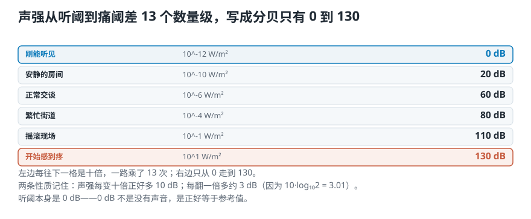
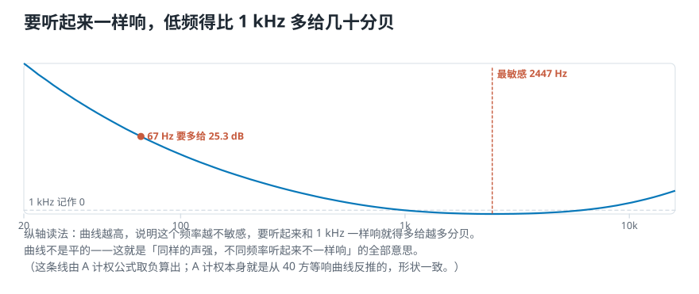
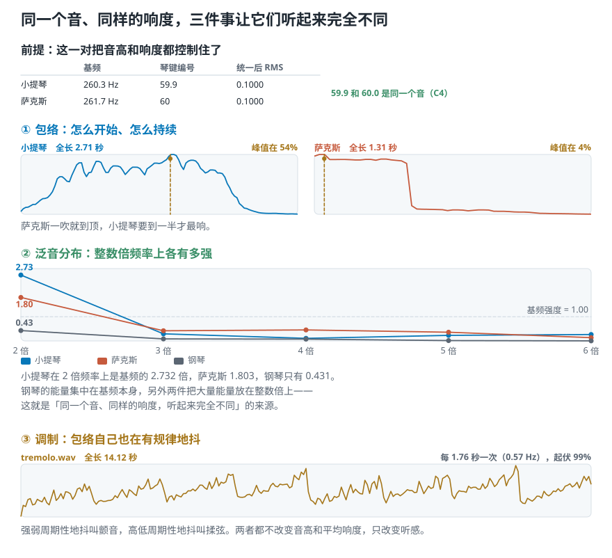
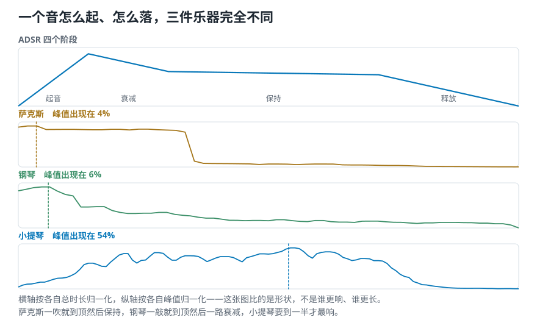
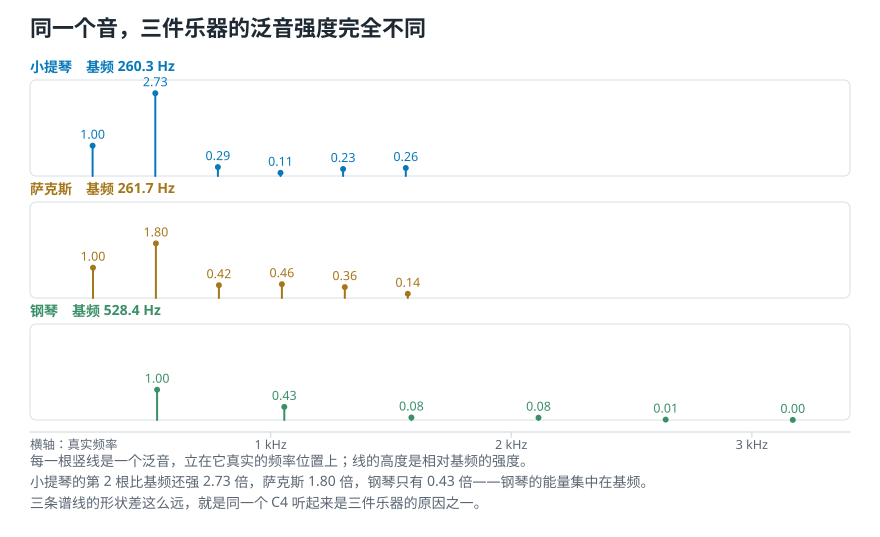
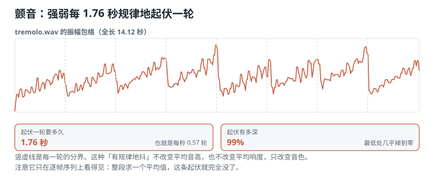

# 第 3 课 强弱、响度与音色：音量一样，为什么听起来不同

> **前情提要：** [第 2 课](02-声音与波形-一次振动怎样变成录音里那条线.md)讲了波形里的频率和振幅：频率定高低，振幅大致定响度。还欠两笔账：强弱到底怎么量；高低和响度都一样时，小提琴和萨克斯为什么还是一听就分得出来。
>
> **本课目标：** 分清声功率、声强、分贝、响度四个词；明白数值一样的两段声音为什么听起来不一样响；能说出音色由哪三样东西决定，并在真实录音上量出来。
>
> **对应视频：** 原课程第 3 集《Intensity, loudness, and timbre》，约 37 分钟（[播放列表](https://www.youtube.com/playlist?list=PL-wATfeyAMNqIee7cH3q1bh4QJFAaeNv0)）。
>
> **配套代码：** 演示脚本 [`lesson03_loudness.py`](../../音频信号处理二十三讲/课程代码/lessons/lesson03_loudness.py)，练习 [`练习/lesson03`](../练习/lesson03/)。

<picture>
  <source media="(max-width: 640px)" srcset="../../音频信号处理二十三讲/第01-05课/figures/mobile/00-course-position-03.svg">
  
</picture>

## 3.1 声功率和声强：一个说声源，一个说你站的位置

从声源往耳朵走，第一个量是**声功率**：**声源每秒向四面八方放出多少能量**，单位瓦特（W），和灯泡上的瓦是同一个单位。它只描述声源本身，你走远两步，它不变。

这个数小得出人意料。一整支交响乐团全力演奏，或者一声响雷，声功率大约只有 **1 瓦**，一只老式白炽灯泡是 100 瓦。耳朵的灵敏，远超直觉。

第二个量是**声强**：**能量传到某个位置，每平方米上通过多少**，单位 W/m²。它描述的是某一个位置，换个地方就变。走得越远，同样的能量摊在越大的面上，每平方米分到的越少。

<picture>
  <source media="(max-width: 640px)" srcset="../../音频信号处理二十三讲/第01-05课/figures/mobile/03-power-vs-intensity.svg">
  
</picture>

*图 1：同一个声源，声功率只有一个数；声强每个位置一个数。*

**麦克风量到的永远是声强这一侧**，它只知道自己那个位置。所以换个位置重录同一个声源，录出来的数就不一样。这不是设备不稳，是两个量本来就不是一回事，也是后面跨录音比较之前必须先统一电平的原因（3.5 节）。

## 3.2 分贝：把十万亿倍压成 0 到 130

人耳能应付的范围大得离谱：

- **听阈**：刚能听见，声强约 $10^{-12}$ W/m²；
- **痛阈**：开始让人疼，声强约 $10$ W/m²。

两者相差 $10^{13}$ 倍，十万亿倍。这样的两个数没法画在同一根轴上：把痛阈画到一米高，听阈那一端连一个原子厚都不到。**所以要换一种记法，这就是分贝。**

$$
L_I = 10\log_{10}\frac{I}{I_0}\ \mathrm{dB}, \qquad I_0 = 10^{-12}\ \mathrm{W/m^2}
$$

**分贝不是一个量，是一种记法**：两个数的比值取对数再乘 10。这里拿听阈当参考值 $I_0$。

<picture>
  <source media="(max-width: 640px)" srcset="../../音频信号处理二十三讲/第01-05课/figures/mobile/03-intensity-ladder.svg">
  
</picture>

*图 2：左边声强每往上一格乘 10，右边写成分贝只是加 10。*

| 声音 | 声强 W/m² | 分贝 |
|---|---|---|
| 刚能听见 | $10^{-12}$ | 0 |
| 耳语 | $10^{-10}$ | 20 |
| 正常交谈 | $10^{-6}$ | 60 |
| 开始感到疼 | $10$ | 130 |
| 喷气式飞机起飞 | $10^{2}$ | 140 |

三条性质记住就够：

- **听阈本身是 0 dB。** 0 dB 不是「没有声音」，是「正好等于参考值」。
- **声强翻一倍，约多 3 dB**，因为 $10\log_{10}2 \approx 3.01$。两台一样的音箱一起放，只比一台多 3 dB，不是两倍响。
- **声强乘 10，正好多 10 dB。**

**分贝永远是相对于某个参考值的。** 参考值换了，同一个声音的分贝数就变。音频软件里显示的 −12 dB，参考值是「数字系统能表示的最大值」，叫 **dBFS**，和房间里有多吵没有关系。

## 3.3 响度：耳朵不是仪表

上面都是仪器量得出的**物理量**。**响度**是另一回事：**人觉得有多响**。它和声强有关，但不由声强单独决定。

最直接的证据：**同样的声强，放在不同频率上，听起来并不一样响。**

<picture>
  <source media="(max-width: 640px)" srcset="../../音频信号处理二十三讲/第01-05课/figures/mobile/03-equal-loudness.svg">
  
</picture>

*图 3：纵轴是「要和 1 kHz 一样响，这个频率得多给多少分贝」。这条线由 A 计权公式算出，它是从一条中等音量的等响曲线反推的，形状一致。*

这种线叫**等响曲线**。脚本按同一个公式算了几个点：

```text
要和 1 kHz 一样响，得多给
   31.5 Hz  +39.5 dB
   62.0 Hz  +26.5 dB  约 447 倍声强
  125.0 Hz  +16.2 dB
  500.0 Hz   +3.2 dB
 1000.0 Hz   +0.0 dB
 2000.0 Hz   -1.2 dB
 4000.0 Hz   -1.0 dB
16000.0 Hz   +6.7 dB
```

耳朵最灵敏的是 **1—5 kHz 这一段**，曲线最低点在 2447 Hz。这差不多正是人说话和唱歌的频率范围，很难说是巧合。往低走迟钝得很快，62 Hz 要多给 447 倍声强才追得上 1 kHz。

响度还受两件事影响：**时长**，同样强度，100 毫秒的短音听着比 600 毫秒的长音轻；**年龄**，同一个声音，不同年纪的人听到的响度不同。等响曲线的形状本身也随音量变：放得越轻，低频掉得越快，这就是一些播放器「小音量补偿」开关的由来。

网页版在这里放了一个实验：先播 1 kHz，再播你选的频率，两个音的振幅完全一样。拖滑杆把第二个音调到听起来一样响，看你的耳朵和等响曲线差多少。

## 3.4 实验：数值一样的两段声音，听感差多少

运行 [`lesson03_loudness.py`](../../音频信号处理二十三讲/课程代码/lessons/lesson03_loudness.py)。它造两段声音：一条 220 Hz 正弦，一段白噪声，把噪声整体缩放，让两段的**均方根**精确相等。均方根就是把每个数平方、求平均、再开方，衡量一段声音整体有多强，第 7 课细讲。

```text
          RMS      质心    平坦度
正弦    0.7071    229 Hz   0.0000
白噪声  0.7071   4001 Hz   0.5610
```

均方根一模一样。可能量放在哪些频率上完全不同：**频谱质心**（能量在频率轴上的平均位置，第 23 课细讲）差 17 倍。上一节刚说过，耳朵对不同频率灵敏度不同。换一个模拟人耳的指标：

```text
  正弦     -4.0 LUFS
  白噪声   -0.4 LUFS
```

**LUFS** 是广播和音频制作里的响度单位，计算前先加一道模拟人耳频率响应的滤波。均方根相同的两段，**LUFS 差了 3.6**。这 3.6 就是频率分布造成的听感差，均方根看不到。

这也解释了标题：**音量条调的是数值，你听到的是响度。** 摇滚的能量更多堆在耳朵灵敏的中高频，同样的数值，它就更吵。

实验的边界要说清：它证明的是两个计算指标不同，不是「主观上谁一定更响」。要下听感结论，还得控制回放音量、房间和实验设计。

## 3.5 统一电平：项目里先做的那一步

既然录音的数值大小取决于录音位置和链路，比较之前就要先把它们拉到同一个电平。三段主素材各取前 10 秒：

```text
       原电平 dBFS   统一后 dBFS   峰值
古典      -24.41       -20.00     0.4512
爵士      -21.33       -20.00     0.6564
摇滚      -20.81       -20.00     0.7476
```

统一就是整段乘一个数，波形形状一点不变。峰值那一列要看一眼：这三段都没超过 1.0，但这不是保证，起伏大的素材拉上来可能越过 1.0，播放时会削顶。

**要整段统一，不要逐帧统一。** 逐帧把每一小段都拉到同样响，强弱起伏就被抹平了：

```text
整段统一后，逐帧 RMS 的起伏程度 0.0458
逐帧统一后，逐帧 RMS 的起伏程度 0.0000
```

「忽强忽弱」本身就是区分音乐风格的证据，逐帧统一等于把它扔了。

## 3.6 音色：对齐之后剩下的差别

现在把高低、响度、时长都对齐，小提琴和萨克斯放在一起，你还是一听就分得出来。**去掉这几样之后剩下的差别，就叫音色。**

音乐人描述音色用的是「亮、暗、暖、尖、闷」这类词，听着模糊，因为它本来就不是一个数能说清的。**音色是多维的**，至少由三样东西决定。先听：

1. [小提琴 C4：慢慢拉到最响](../../source_course/audio_resources/violin_c.wav)
2. [萨克斯 C4：很快进入稳定段](../../source_course/audio_resources/sax.wav)
3. [钢琴 C5：敲下后持续衰减](../../source_course/audio_resources/piano_c.wav)

```text
          时长   基频 Hz    编号
小提琴   2.71s    260.3    59.9
萨克斯   1.31s    261.7    60.0
钢琴     1.54s    528.4    72.2
```

小提琴 59.9、萨克斯 60.0，是同一个音 C4，统一电平后均方根也精确相同。钢琴 72.2 高一个八度，所以「同音高不同音色」这一对只能用前两个。

<picture>
  <source media="(max-width: 640px)" srcset="../../音频信号处理二十三讲/第01-05课/figures/mobile/03-timbre-three.svg">
  
</picture>

*图 4：三样东西共同决定音色。下面逐个在真实录音上量。*

### 包络：声音怎么开始、怎么结束

**包络**是一个音的强弱随时间的轮廓。经典描述叫 **ADSR**：**起音**（从无声冲到最响）、**衰减**（从最响回落）、**保持**（中间稳定的一段）、**释放**（松手后消失）。

<picture>
  <source media="(max-width: 640px)" srcset="../../音频信号处理二十三讲/第01-05课/figures/mobile/03-adsr.svg">
  
</picture>

*图 5：上面是 ADSR 四个阶段；下面是三件乐器实测的包络，横轴按各自总时长归一化。*

```text
小提琴  全长 2.71 秒，第 1.46 秒到最响
萨克斯  全长 1.31 秒，第 0.05 秒到最响
钢琴    全长 1.54 秒，第 0.09 秒到最响
```

萨克斯一吹就到顶然后保持；钢琴一敲就到顶然后一路衰减；小提琴是拉出来的，弓压慢慢加，一秒半才最响。钢琴的起音还夹着琴槌的敲击声，是一小段瞬态。

**起音是认乐器的强线索。** 把钢琴开头那几十毫秒去掉，很多人就认不出是钢琴了，即使后面完全没动。

网页版在这里放了一个实验：把三段真实录音的开头切掉一截再听，看看还认不认得出。

### 泛音：一个音里其实有很多个频率

第 2 课说过，复杂声音可以拆成一组正弦。这里说细：

- 每一条正弦叫一个**分音**；
- 最低的那条叫**基频**，决定你听到的音高；
- 频率正好是基频整数倍的分音，叫**泛音**。440 Hz 的音，泛音在 880、1320、1760 Hz……
- 分音偏离整数倍的程度叫**非谐性**。小提琴、长笛、人声的分音基本落在整数倍上，音高明确；钹、锣、大多数鼓偏得厉害，说不出是什么音；噪声完全没有整数倍关系。

前 6 个整数倍上的强度（相对基频）：

| 第几倍 | 1 | 2 | 3 | 4 | 5 | 6 |
|---|---|---|---|---|---|---|
| 小提琴 | 1.00 | **2.73** | 0.29 | 0.11 | 0.23 | 0.26 |
| 萨克斯 | 1.00 | **1.80** | 0.42 | 0.46 | 0.36 | 0.14 |
| 钢琴 | 1.00 | **0.43** | 0.08 | 0.08 | 0.01 | 0.00 |

<picture>
  <source media="(max-width: 640px)" srcset="../../音频信号处理二十三讲/第01-05课/figures/mobile/03-harmonics.svg">
  
</picture>

*图 6：每根竖线是一个泛音，高度是相对基频的强度。*

小提琴的 2 倍频率比基频还强 2.7 倍，萨克斯 1.8 倍，钢琴只有 0.43 倍。**钢琴的能量集中在基频，另外两件把大量能量放在整数倍上。** 能量在泛音上怎么分，是同一个音听起来不一样的第二个来源。

### 调制：声音自己在有规律地抖

前两样假设音是稳的。演奏时常常故意让它抖：

- **揉弦**（vibrato）：**音高**周期性地上下抖，弦乐手按弦的手指来回摇。专业说法叫调频。
- **颤音**（tremolo）：**强弱**周期性地起伏。专业说法叫调幅。

两者都不改变平均音高和平均响度，只改变音色。听课程自带的一段：[颤音 tremolo.wav](../../source_course/audio_resources/tremolo.wav)。

```text
全长 14.12 秒
起伏最强的频率 0.57 Hz
也就是每 1.76 秒一轮
包络最大 0.238、最小 0.001
起伏幅度 99%
```

<picture>
  <source media="(max-width: 640px)" srcset="../../音频信号处理二十三讲/第01-05课/figures/mobile/03-tremolo.svg">
  
</picture>

*图 7：逐帧算出的包络，每 1.76 秒一轮，最低处几乎掉到零。*

起伏幅度 99%，每一轮里声音几乎完全消失又回来。**这种规律的抖动，只看整段平均值的特征抓不到**，必须保留逐帧的序列。第 5 课会正式讲这一点。

网页版在这里放了一个实验：用三件乐器实测的泛音比例和包络形状，自己拼一个音，再加上揉弦或颤音，一样一样换着听。

## 📌 本课小结

- **声功率说声源，声强说位置。** 麦克风只量得到声强这一侧，换个位置录，数就变。
- **分贝是比值的对数记法**，把十万亿倍压成 0 到 130。翻一倍约加 3 dB，乘十加 10 dB；参考值换了，读数就变。
- **响度是耳朵的判断。** 同样强度，62 Hz 要多给约 447 倍才和 1 kHz 一样响；均方根相同的两段，LUFS 能差 3.6。
- **比较之前先统一电平，整段统一，不要逐帧。** 逐帧统一会抹掉强弱起伏这条证据。
- **音色是三件事**：包络（怎么起怎么落）、泛音（整数倍上各有多强）、调制（自己抖不抖）。

## 📖 本课术语

| 中文 | 英文 | 一句话解释 | 首次出现 |
|---|---|---|---|
| 声功率 | Sound power | 声源每秒放出的能量，单位瓦特，和听者位置无关 | 第 03 课 |
| 声强 | Sound intensity | 某个位置上每平方米通过的声能，换个位置就变 | 第 03 课 |
| 听阈 / 痛阈 | Threshold of hearing / pain | 刚能听见和开始疼的声强，相差十万亿倍 | 第 03 课 |
| 分贝 | Decibel (dB) | 两个数比值取对数再乘 10 的记法，必须说明参考值 | 第 03 课 |
| dBFS | Decibels relative to full scale | 以数字系统能表示的最大值为参考的分贝，最大是 0 | 第 03 课 |
| 响度 | Loudness | 人觉得有多响，受频率、时长、年龄影响 | 第 02 课 |
| 等响曲线 | Equal-loudness contour | 听起来一样响时，各频率需要的强度连成的线 | 第 03 课 |
| LUFS | Loudness units relative to full scale | 先模拟人耳频率响应再算的响度单位 | 第 03 课 |
| 音色 | Timbre | 高低、响度、时长都对齐后剩下的差别 | 第 02 课 |
| 包络 / ADSR | Envelope / ADSR | 强弱随时间的轮廓：起音、衰减、保持、释放 | 第 03 课 |
| 基频 / 泛音 | Fundamental / Harmonic | 最低的分音定音高；整数倍上的分音叫泛音 | 第 03 课 |
| 非谐性 | Inharmonicity | 分音偏离整数倍的程度，偏得越多音高越模糊 | 第 03 课 |
| 揉弦 / 颤音 | Vibrato / Tremolo | 音高周期性地抖 / 强弱周期性地抖 | 第 03 课 |

## 🧪 动手练习

练习在 [`练习/lesson03`](../练习/lesson03/)：打开 `exercise.py`，把标着 `TODO` 的地方补上，再运行一条命令检查。

```bash
pytest 音频信号处理二十三讲-v2/练习/lesson03        # 检查你写的
pytest 音频信号处理二十三讲-v2/练习/lesson03 --solution   # 看参考答案能不能过
```

1. **声强换分贝**：写 `intensity_to_db(I)`，听阈是 0 dB，痛阈是 130 dB，翻一倍约加 3 dB。
2. **数字电平**：写 `dbfs(y)`，用均方根算一段数字音频的 dBFS。满幅正弦应是约 −3 dB。
3. **整段统一电平**：写 `normalize_to(y, target_dbfs)`，三段主素材的前 10 秒统一到 −20 dBFS 后，波形形状不变。
4. **量泛音**：写 `harmonic_ratios(y, sr, f0, n)`，用合成的已知音（泛音比例 1 : 0.5 : 0.25）检查你量得对不对。

## ✅ 小测验

**1. 你离音箱远走两步，下面哪个量不变？**

- A. 声强
- B. 声功率
- C. 麦克风录到的数值
- D. 分贝读数

<details><summary>看答案</summary>

**B**。声功率描述声源本身。声强、录到的数值、分贝读数都和你站的位置有关。

</details>

**2. 两台一模一样的音箱一起放，比一台多多少分贝？**

- A. 约 3 dB
- B. 约 6 dB
- C. 10 dB
- D. 翻一倍，比如 60 dB 变 120 dB

<details><summary>看答案</summary>

**A**。声强翻一倍，$10\log_{10}2 \approx 3.01$ dB。分贝是对数记法，翻倍不等于读数翻倍。

</details>

**3. 均方根完全相同的正弦和白噪声，为什么 LUFS 差了 3.6？**

- A. 均方根算错了
- B. LUFS 先模拟了人耳对不同频率的灵敏度，两段能量落在不同频率上
- C. 白噪声更长
- D. LUFS 只看峰值

<details><summary>看答案</summary>

**B**。正弦的能量集中在 220 Hz，白噪声铺满整个频率轴，大量落在耳朵灵敏的中高频。均方根不看频率，LUFS 看。

</details>

**4. 三段音乐比较之前要统一电平。为什么不逐帧统一？**

- A. 逐帧太慢
- B. 逐帧统一会把强弱起伏抹平，丢掉一条证据
- C. 逐帧统一会改变音高
- D. 逐帧统一会让峰值超过 1

<details><summary>看答案</summary>

**B**。逐帧统一后，逐帧均方根的起伏从 0.0458 变成 0，「忽强忽弱」这条信息没了。

</details>

**5. 小提琴和萨克斯拉同一个 C4、同样响，下面哪一项不是它们听起来不同的原因？**

- A. 起音快慢不同
- B. 泛音上的能量分布不同
- C. 基频不同
- D. 演奏时有没有揉弦

<details><summary>看答案</summary>

**C**。两者基频 260.3 和 261.7 Hz，是同一个音。音色差别来自包络、泛音和调制。

</details>

## 下一课

到这里，声音本身讲完了：振动、波形、高低、强弱、音色。可这些都是连续变化的物理量，计算机一个也存不下。[第 4 课](../../音频信号处理二十三讲/第01-05课/04-模拟声到数字录音-连续的声音怎样变成一串数字.md)讲连续的声音怎样变成第 1 课看到的那一长串数，又在哪一步永远丢掉了什么。
